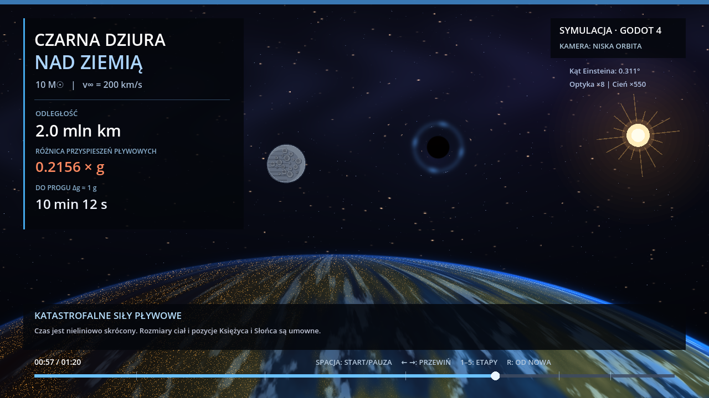
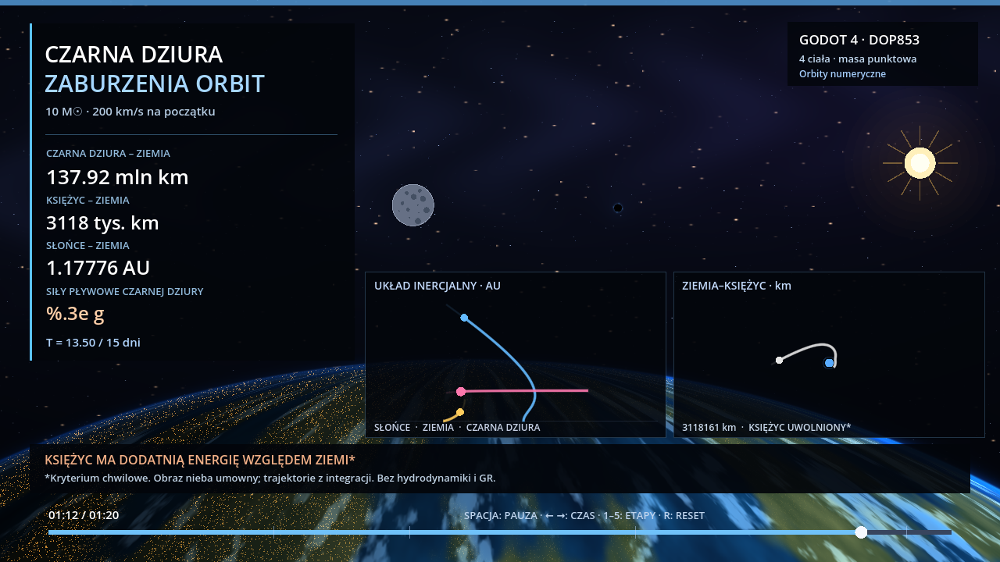

# Black Hole Flyby — Earth (Godot 4)

An interactive 80-second, 2D visualization of a **10-solar-mass black hole passing directly toward Earth**. The camera is just above Earth's curved horizon, looking into deep space. The Moon and Sun are both visible. The planet, Moon, Sun, starfield and lensing effects are procedural; there are no borrowed images or video assets.

Inspired by [LunarzoneAnimates' YouTube Short](https://www.youtube.com/shorts/9KLW4rp-ou8). The animation is original and is **not** a frame-by-frame reproduction.

## Run

Open `project.godot` in **Godot 4.4+** and press `F6` / Run Current Scene, or launch the project with `F5` / Run Project.

```bash
godot --path .
```

| Control | Action |
| --- | --- |
| Space | Pause / resume |
| Left / right | Step backward / forward three seconds |
| 1–5 | Jump to five significant stages |
| R | Restart |
| Home / End | Jump to start / end |
| F | Toggle fullscreen |
| Click or drag the bottom timeline | Scrub |

## Screenshots

The following four screenshots were **captured from the actual Godot 4.4.1 runtime** by the GitHub Actions CI job using a virtual display:

| Distant | Gravitational lensing |
| --- | --- |
|  |  |
| Tidal forces | Hypothetical post-disruption view |
|  |  |

To capture the four stages locally with Godot 4.4+:

```bash
godot --path . -- --capture-dir=./screenshots
```

The command saves four images and quits. It needs a working graphical display and renderer; `--headless` does not render video frames.

## Physical model

- Black-hole mass: `10 M☉`.
- Asymptotic approach speed: `200 km/s`.
- Schwarzschild radius: `29.53 km`.
- Tidal difference between Earth center and near-side surface (first-order approximation): `Δa ≈ 2GM R⊕ / d³`.
- The condition `Δa = 1 g` occurs at approximately **1.199 million km** from Earth's center.
- Angular Einstein radius for effectively distant background stars: `θE ≈ √(4GM / (c²d))`.
- Shadow's small-angle radius: `θshadow ≈ 3√3 GM / (c²d)` for a nonrotating black hole.
- Radial speed: `v(r) = √(v∞² + 2GM/r)`; the displayed countdown uses the analytical integral of `dr/v(r)` to the `Δa = 1 g` threshold.

This is a **pedagogical toy model, not numerical relativity**. It assumes a nonrotating isolated black hole, radial approach, a static observer for the sky projection, distant background stars and Newtonian two-body radial motion. Earth would accelerate toward the hole, deform, develop extreme tidal effects and lose its ability to host an observer well before the final cinematic frames. The instant at which `Δa = 1 g` is **not an exact destruction time**, and disruption depends on Earth's dynamical response and internal structure.

## Visualization vs. physical scale

To make a black hole visible in a 720-pixel-high frame, two quantities are deliberately magnified: the computed Einstein angular radius by **8×**, and the computed shadow radius by **550×**. The shadow also has a minimum and maximum rendered size. The thin blue lensing arc is an **illustrative graphic**, not a luminous accretion disk or a guaranteed Einstein ring. The original physical quantities in the information panel are not magnified. The timeline is intentionally nonlinear, so **80 seconds of animation do not represent 80 seconds of physical time**.

The dark circular shape is not a scientifically faithful rendering of the true apparent shadow; the actual shadow would appear extremely small long before Earth was disrupted. The orbit-height camera, planet textures, Sun and Moon sizes, and Moon/Sun positions are artistic devices, not scale-accurate ephemerides. No claims are made about global earthquake timing, ocean response, precise Roche limit, or human survivability.

## Tests

```bash
godot --headless --path . --editor --quit
godot --headless --path . --script res://tests/physics_test.gd
```

## Sources

- [NASA — Black Holes](https://science.nasa.gov/universe/black-holes/) (visibility, gravitational lensing, long-range gravity).
- [NASA — Anatomy of a Black Hole](https://science.nasa.gov/universe/black-holes/anatomy/) (event horizon, black hole shadow, lensing).
- [Godot — CanvasItem shaders](https://docs.godotengine.org/en/stable/tutorials/shaders/shader_reference/canvas_item_shader.html) (rendering).
- [Godot — Screen capture and rendering](https://docs.godotengine.org/en/stable/classes/class_renderingserver.html) (capture frame timing).

## Complete movie (80 seconds)

The GitHub Actions workflow exports the entire 80-second scene using the Godot Movie Maker, at 1280×720 and 15 FPS, and converts it into H.264 MP4. Download the artifact named `black-hole-flyby-orbit-mp4` from a successful `Godot validate and screenshot` workflow run. The runtime screenshots show the same orbital scene. The original source can be opened in Godot 4.4+.

The film is silent and is an educational visualization; its moving sky and destruction effects are stylized rather than physically complete.
